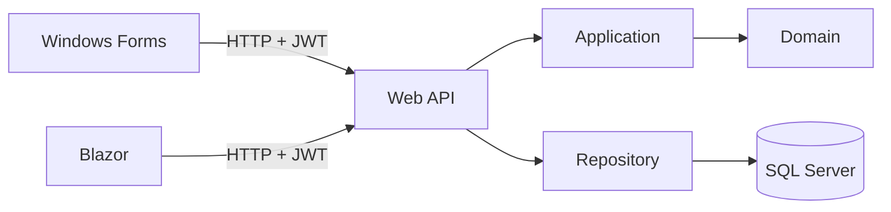
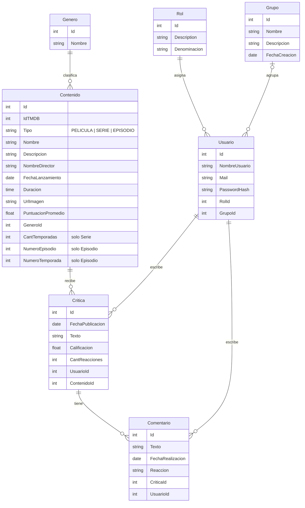

# Calificar Películas — Trabajo Práctico Integrador .NET

## Integrantes
* Julia Aguaya - Legajo 49459
* Martín Quagliardi - Legajo 51657
* Laureano Toloza - Legajo 51871

## Descripción
Aplicación para publicar críticas sobre películas, series y episodios, y comentar las críticas de otros usuarios. Tiene una interfaz de escritorio (Windows Forms) y una interfaz web (Blazor), que consumen la misma API REST protegida con tokens JWT.

## Arquitectura

| Proyecto | Capa | Responsabilidad |
|---|---|---|
| `CalificarPeliculas.Domain` | Modelo de dominio | Entidades y validaciones de negocio |
| `CalificarPeliculas.Application` | Servicios | DTOs, interfaces de servicios y repositorios, lógica de aplicación, hash de contraseñas |
| `CalificarPeliculas.Repository` | Acceso a datos | Entity Framework Core (SQL Server), una consulta con ADO.NET y carga de datos de prueba |
| `CalificarPeliculas.Web` | API | Minimal API REST, autenticación JWT, autorización por roles y Swagger |
| `CalificarPeliculas.Blazor` | UI Web | Blazor Server que consume la API |
| `CalificarPeliculas.WindowsForms` | UI Desktop | Windows Forms que consume la API |

## Roles

| Funcionalidad | SuperUsuario | Moderador | Usuario |
|---|:-:|:-:|:-:|
| Géneros y Contenidos (ABM) | ✔ | ✔ | — |
| Críticas y Comentarios | Todos | Todos | Ver todos, modificar solo los propios |
| Usuarios y Grupos (ABM) | ✔ | — | — |
| Reportes | ✔ | ✔ | — |

## Modelo de datos
`Pelicula`, `Serie` y `Episodio` heredan de `Contenido` y se guardan en una sola tabla (TPH) cuyo discriminador es la columna `Tipo`.

## Usuarios de prueba

| Rol | Mail | Contraseña |
|---|---|---|
| SuperUsuario | admin@gmail.com | Admin123! |
| Moderador | moderador@gmail.com | Moderador123! |
| Usuario | lucia@gmail.com, tomas@gmail.com, valentina@gmail.com | Usuario123! |